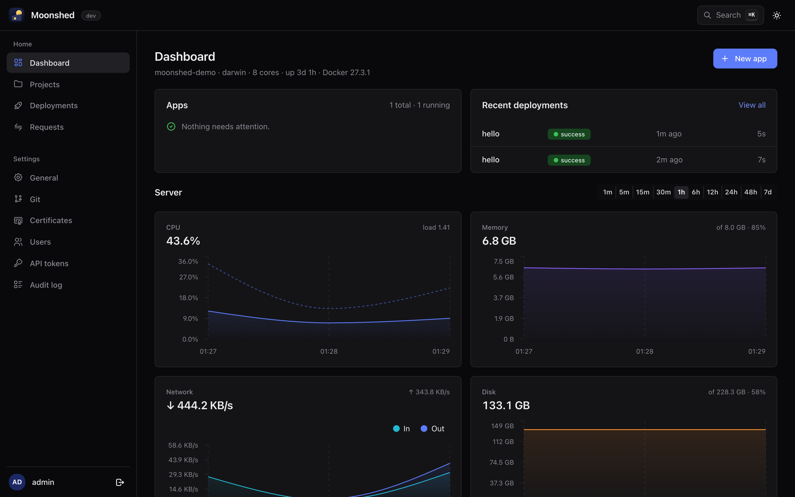
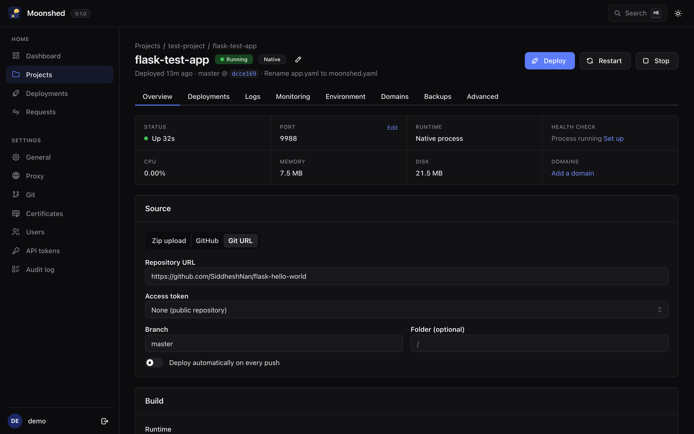
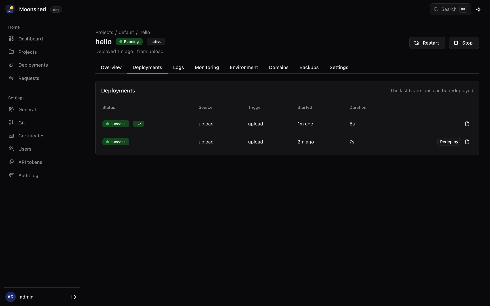
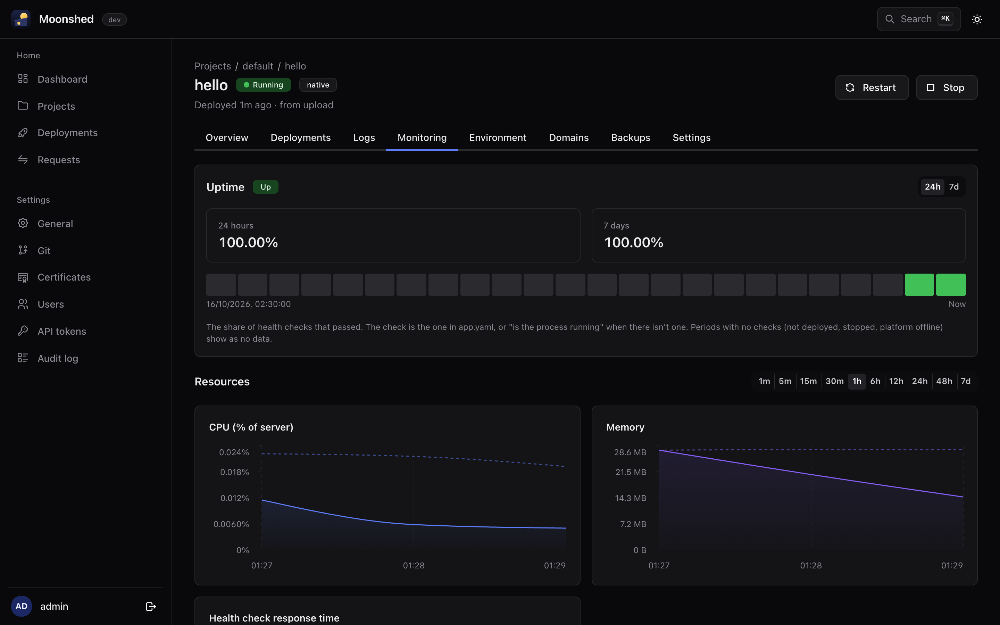

<p align="center"></p>

<h1 align="center">Moonshed</h1>

<p align="center">A small, self-hosted platform for deploying your apps.<br>One Go binary + SQLite. Runs on Linux and Windows.</p>

> **Status: early development.** Moonshed is pre-release. Expect rough edges and breaking changes.



| App overview | Deployments | Monitoring |
|---|---|---|
|  |  |  |

## Why Moonshed

Moonshed is a lightweight alternative to platforms like Dokploy, built to run comfortably on 1 core / 1 GB RAM:

- **One binary, one SQLite file.** No Postgres, Redis or Traefik. Docker is optional.
- **Linux and Windows.** Runs as a systemd unit or a Windows service.
- **Native or Docker, per app.** Run an app as a plain supervised process, or as a container.

## Features

- **Deploy** from a zip upload, a git repo, or CI with an API token. Builds have their own log and can be killed.
- **Safe rollouts.** A new release starts with a health check, and you can redeploy earlier versions.
- **Live logs** streamed to the UI.
- **Built-in reverse proxy** with domains and automatic HTTPS (Let's Encrypt), or your own certificate.
- **Monitoring.** CPU, memory, disk and network graphs, uptime from real health checks, and a request log.
- **Backups** for each app and for Moonshed itself, on a schedule or on demand.
- **Teams.** Projects, users, API tokens and an audit log.

## Install

Needs Go 1.26+, Node 20+ and Python 3 to build.

```bash
./scripts/build.py
```

It asks for the version, the target platforms, the output folder and whether to run the tests (Enter accepts the defaults), then writes a bundle per target:

```
dist/linux-amd64/
  moonshed
  runtime/
    config/production.yaml
    web/                      the UI
```

Copy a bundle to your server, check `runtime/config/production.yaml`, then as root / Administrator:

```bash
./moonshed install -e production
```

This registers a systemd unit (Linux) or a Windows service and starts it on boot. Open `http://<server>:5050` and create the admin account. The rest of `runtime/` (database, apps, logs, backups) is created on first run.

Other commands:

```bash
./moonshed serve -e production     # run in the foreground
./moonshed uninstall
./moonshed reset-password admin
```

`-e` (or `ENV`) picks `runtime/config/<env>.yaml` and is required; Moonshed exits if the file is missing or incomplete. `--runtime` (or `RUNTIME_DIR`) defaults to `runtime/` next to the binary.

## Deploy an app

Deploy from a git repository or a zip. Describe how to run it in a `moonshed.yaml` at the root, or set the same things in the app's Build settings; a `Dockerfile` alone also works:

```yaml
pre: |
  python3 -m venv .venv
  .venv/bin/pip install -r requirements.txt
run: .venv/bin/python app.py
persist:
  - data/
health:
  http: /healthz
```

Settings made in the UI override the file. Zips can be uploaded in the UI, or from CI with an API token:

```bash
curl -fsS -H "Authorization: Bearer $MOONSHED_TOKEN" -H "Content-Type: application/zip" \
  --data-binary @app.zip https://panel.example.com/api/apps/$APP_ID/deploy
```

Scripts can be one-liners, multi-line blocks, a path to a `.sh`/`.ps1`/`.cmd` file, or per-OS (`linux:` / `windows:`). See [examples/python-app](examples/python-app) for a working bundle.

## Development

```bash
go run ./cmd/moonshed serve -e development
cd ui && npm install && npm run dev
```

Open http://localhost:5050. See [CONTRIBUTING.md](CONTRIBUTING.md) for the project layout and conventions.

## Docs

[DESIGN.md](docs/DESIGN.md) explains how it works: the bundle format, runtimes, the deploy flow, the proxy, monitoring, backups and the API.

## Contributing

Issues and pull requests are welcome. Moonshed is early, so please open an issue to discuss bigger changes first. See [CONTRIBUTING.md](CONTRIBUTING.md), and report security issues as described in [SECURITY.md](SECURITY.md).

## License

[AGPL-3.0](LICENSE). You can use, modify and self-host Moonshed freely; if you offer a modified version to others as a network service, you must publish your changes under the same license.
