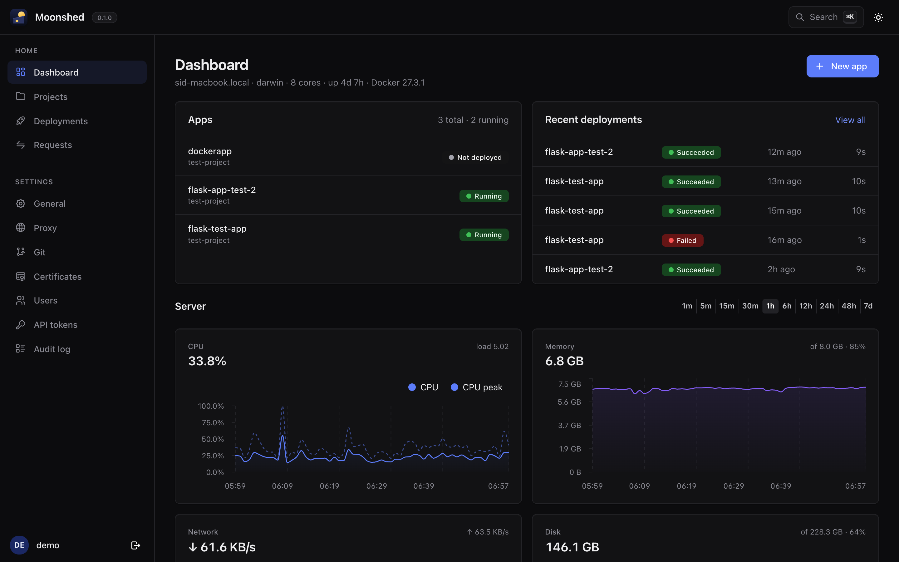
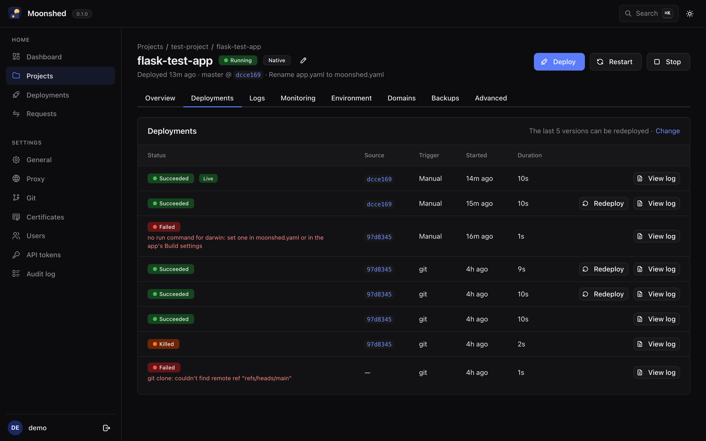
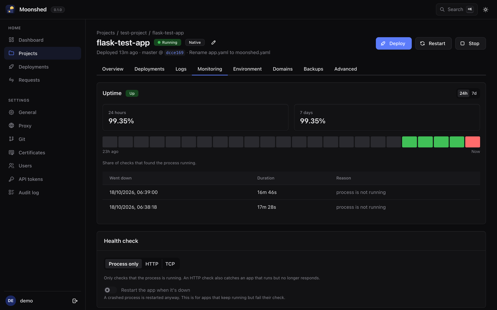
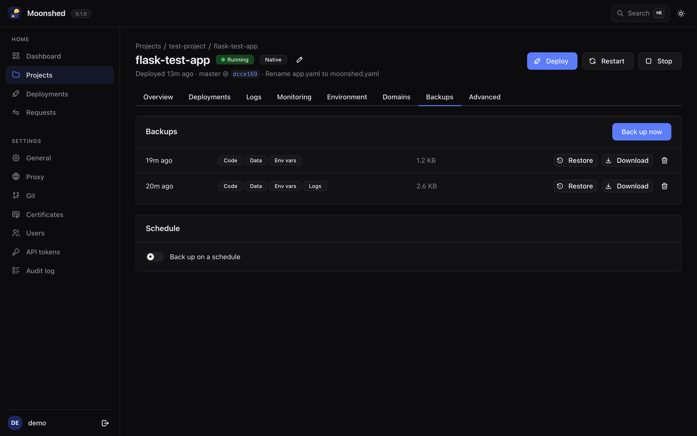

<p align="center"></p>

<h1 align="center">Moonshed</h1>

<p align="center">A small, self-hosted platform (PaaS) for deploying your apps.<br>One binary and SQLite. Runs on Linux and Windows.</p>

<p align="center">
  <a href="https://moonshed.siddhesh.me">Website</a> ·
  <a href="https://moonshed.siddhesh.me/docs/">Docs</a> ·
  <a href="https://moonshed.siddhesh.me/docs/reference/moonshed-yaml">moonshed.yaml</a> ·
  <a href="CHANGELOG.md">Changelog</a>
</p>

> **Status: early development.** Moonshed is pre-release. Expect rough edges and breaking changes.



## Why Moonshed

Platforms like Dokploy and Coolify are great, but they bring a stack with them: Postgres, Redis, Traefik and Docker before your first app is even running. Moonshed is built for the small server or a minimal setup.

- **One binary, one SQLite file.** The reverse proxy (Caddy) is built in. Nothing else to install or keep running.
- **Light.** Comfortable on 1 core and 1 GB of RAM. The platform itself used about 15 MB of memory running three apps.
- **Docker is optional.** Run an app as a plain process that Moonshed supervises (like how pm2 does), or as a container. You choose per app.
- **Linux and Windows.** Runs as a systemd unit or a Windows service, and Native Process apps run on either.
- **Config in the repo or the UI.** A `moonshed.yaml` next to your code, the same settings in the panel, or just a Dockerfile.


## Features

**Deploy**
- From GitHub through a GitHub App (private repos without personal tokens), any git URL, a zip upload, or CI with an API token.
- Deploy on every push, or see "new commit waiting" and deploy when you're ready.
- Docker builds with BuildKit: custom Dockerfile path, build folder, stage and build arguments.
- A new version has to pass its health check before it replaces the old one; if it fails, the old version is started again.
- Redeploy any of the last few versions with one click.

**Run**
- Built-in reverse proxy (Caddy) with domains, path routing and automatic HTTPS (Let's Encrypt), or your own certificate.
- Per-domain options: HTTPS redirect, HSTS, compression, basic auth, IP allow lists, headers, body size limits, and raw Caddyfile for the rest.
- Encrypted env vars, persistent data folders that survive deploys, and per-app OS users for Native Process apps.
- Live logs for every app and every deployment.

**Watch**
- CPU, memory, disk and network graphs for the server and each app, plus traffic per domain.
- Uptime and incidents from health checks, with optional auto-restart.
- A request log you can turn on per app.

**Keep safe**
- App backups of code, data, env vars and logs, on a schedule or on demand. They unpack to a plain copy of the app and restore part by part.
- Platform backups of Moonshed's own database.
- Projects, users, API tokens and an audit log of every change.

| App overview | Deployments |
|---|---|
|  |  |
| **Monitoring** | **Backups** |
|  |  |

## Quick start

Download the latest release on your server and install it as a service:

```bash
cd /opt
curl -fsSL https://github.com/SiddheshNan/moonshed/releases/latest/download/moonshed-linux-amd64.tar.gz | sudo tar -xz
cd moonshed
sudo ./moonshed install -e production
```

Open `http://<server>:5050` and create the admin account.

Releases are built for Linux (x86-64 and ARM64) and Windows (x86-64). See the [installation guide](https://moonshed.siddhesh.me/docs/installation) for Windows, putting the panel behind HTTPS, upgrading, and building from source.

## Deploy an app

Describe the app in a `moonshed.yaml` at its root, or set the same things in the app's Build settings:

```yaml
pre: |
  python3 -m venv .venv
  .venv/bin/pip install -r requirements.txt
run: .venv/bin/python app.py
port: 8000
persist:                 # kept across deploys
  - data/
health:
  http: /healthz
restart_unhealthy: true
```

Then create the app in the panel, point it at a repository or upload a zip, and press Deploy. From CI, upload a zip with an API token:

```bash
curl -fsS -H "Authorization: Bearer $MOONSHED_TOKEN" -H "Content-Type: application/zip" \
  --data-binary @app.zip https://panel.example.com/api/apps/$APP_ID/deploy
```

[examples/](examples) has working apps to try: a [Flask hello world](examples/flask-hello), a [FastAPI todo list](examples/fastapi-todo) backed by SQLite, and a [Snake game](examples/node-snake) on Node and Express. The [moonshed.yaml reference](https://moonshed.siddhesh.me/docs/reference/moonshed-yaml) lists every key.

## Good to know

Moonshed keeps things simple on purpose. Today it:

- runs on **one server**; there is no multi-server mode yet,
- has a **short gap during a deploy** while the old version stops and the new one starts,
- has **no resource limits** per app yet,
- doesn't sandbox Native Process apps; give an app its own OS user to limit what it can touch.

These are on the list for later versions.

## Documentation

- [Docs](https://moonshed.siddhesh.me/docs/): guides for installing, deploying, domains, monitoring and backups. The source is in [website/](website).
- [DESIGN.md](docs/DESIGN.md): how Moonshed works inside, for contributors.

Run the docs site locally:

```bash
cd website && npm install && npm run dev
```

## Development

```bash
go run ./cmd/moonshed serve -e development
cd ui && npm install && npm run dev
```

Open http://localhost:5050. In development the panel forwards the UI to the Vite dev server, so changes show up live. See [CONTRIBUTING.md](CONTRIBUTING.md) for the project layout and conventions.

## Contributing

Issues and pull requests are welcome. Moonshed is early, so please open an issue to discuss bigger changes first. See [CONTRIBUTING.md](CONTRIBUTING.md), and report security issues as described in [SECURITY.md](SECURITY.md).

## License

[AGPL-3.0](LICENSE). You can use, modify and self-host Moonshed freely; if you offer a modified version to others as a network service, you must publish your changes under the same license.
